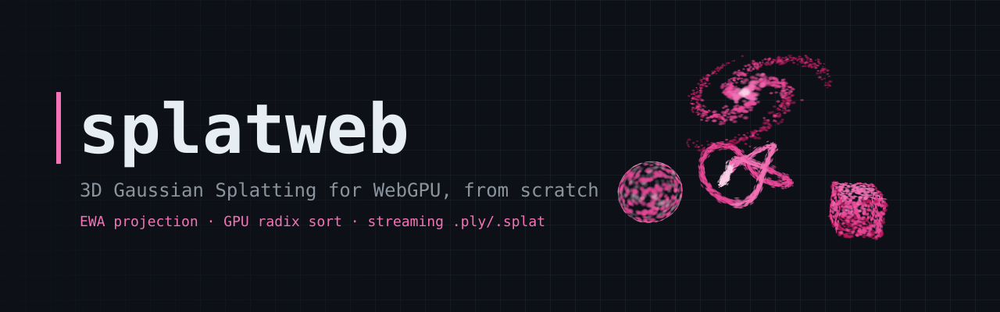
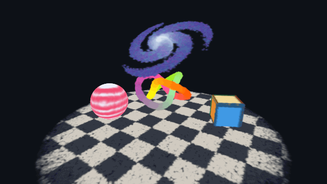
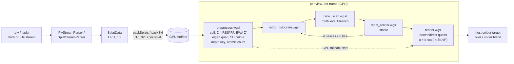
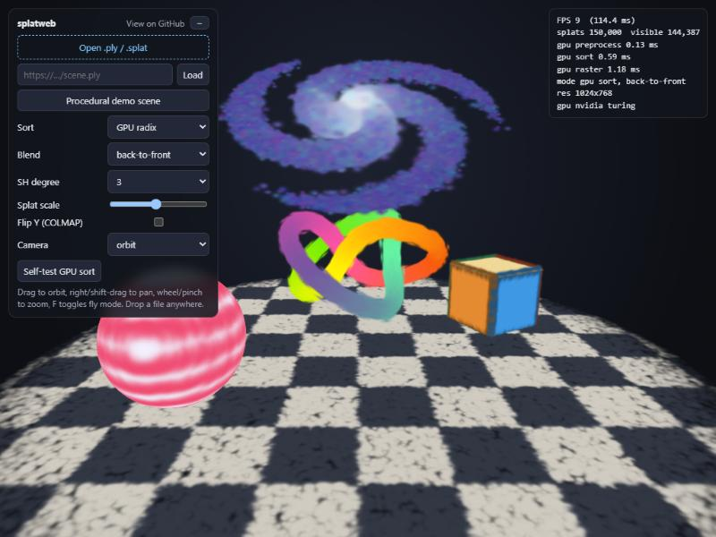

<div align="center">



[](https://github.com/coopersimpson101-debug/splatweb/actions/workflows/ci.yml)
[](https://github.com/coopersimpson101-debug/splatweb/releases/latest)
[](https://github.com/coopersimpson101-debug/splatweb/actions/workflows/pages.yml)
[](LICENSE)
[](src)
[](https://www.w3.org/TR/webgpu/)

[](https://coopersimpson101-debug.github.io/splatweb/)

</div>

**A 3D Gaussian Splatting renderer for WebGPU, written from scratch in TypeScript and WGSL.**
Scan a room with a phone and fly through it in real time in the browser, or embed the renderer
core in your own engine. No three.js, no Babylon: loaders, EWA projection, spherical harmonics,
the GPU radix sort and blending are hand-written and tested against CPU references on a real GPU.

[Live demo](https://coopersimpson101-debug.github.io/splatweb/) ·
[How it works](#how-it-works) ·
[Results](#results) ·
[Capture pipeline](docs/capture-pipeline.md) ·
[Embedding](docs/vanta-integration.md) ·
[Status](#status)

<div align="center">



<sub>Real output of this renderer: a 60-frame orbit of the built-in procedural scene (150k splats, SH degree 3),
rendered headless through Dawn on an RTX 2060 by <a href="scripts/capture_gif.ts"><code>scripts/capture_gif.ts</code></a>
(<code>npm run capture:gif</code>). The live demo renders the same scene. Full-resolution still:
<a href="docs/images/demo.png"><code>docs/images/demo.png</code></a> (<code>npm run render</code>).</sub>

</div>

## Highlights

- **From-scratch WebGPU pipeline**: compute preprocess → 4-pass GPU LSD radix sort → instanced, eigen-aligned quads via `drawIndirect`.
- **EWA splatting done properly**: `Σ' = J W Σ Wᵀ Jᵀ + 0.3 I`, checked against finite differences and a 200k-sample Monte-Carlo estimate (within 2%).
- **Hand-written GPU radix sort**: histogram → multi-level Blelloch scan → stable scatter; bit-exact vs a CPU reference up to 600k keys.
- **Streaming loaders** for 3DGS `.ply` (SH up to degree 3, any property order or endianness) and `.splat`; splats draw while the file downloads.
- **Tested on real hardware**: 5 of the 60 tests run the actual WGSL through Dawn on an RTX 2060; blending matches CPU compositing to < 2/255.
- **Measured, not guessed**: 150k splats at 1080p in 2.62 ms of GPU time (headless, timestamp queries; table below).
- **Embeddable**: `SplatRenderer` renders into a host's `GPUDevice`, encoder and target, with an optional depth test.

## Quickstart

```bash
git clone https://github.com/coopersimpson101-debug/splatweb && cd splatweb
npm install
npm run dev          # http://localhost:5173 , drop any .ply / .splat on the page
npm test             # 60 tests; the GPU suite runs if Dawn finds an adapter
npm run capture:gif  # re-record the GIF above on your own GPU
```

---

## Features

| Area | What is implemented |
|---|---|
| **Formats** | Standard 3DGS `.ply` (Inria / gsplat / nerfstudio): positions, log-scales, rotation quaternions, opacity logits, SH DC plus `f_rest_*` up to degree 3. Any property order or scalar type, little or big endian. Plain point-cloud PLYs (COLMAP `points3D`) load too. Compact antimatter15 `.splat` (32 B/splat). Writers for both formats. |
| **Streaming** | `fetch` `ReadableStream` / `File.stream()` with incremental parsers. Splats are uploaded and drawn while the file is still downloading. |
| **GPU packing** | 32 B/splat (f32 position, f16 scale/opacity/quaternion) plus f16 SH (96 B at degree 3 instead of 192 B). The f32 to f16 conversion is written by hand and bit-exact with WGSL `unpack2x16float`. |
| **Preprocess (compute)** | One thread per splat: opacity, near-plane and screen-rect culling, `Σ = R S Sᵀ Rᵀ`, EWA projection `Σ' = J W Σ Wᵀ Jᵀ + 0.3 I`, eigen-decomposition into an oriented quad, conic and radius, SH evaluation (degrees 0 to 3), depth key, and an atomic visible count written straight into the indirect draw arguments. |
| **Sorting** | A GPU LSD radix sort written from scratch: 4 passes × 8 bits, each pass doing per-block histogram → multi-level Blelloch scan → stable scatter. A CPU radix-sort fallback is included. |
| **Raster** | Instanced, eigen-aligned quads (`drawIndirect`). The Gaussian falloff is evaluated in quad space. Output is premultiplied alpha with **back-to-front ("over")** or **front-to-back ("under")** blending. Optional read-only depth test against host geometry. |
| **Viewer** | Orbit and FPS fly cameras, touch support (rotate, pinch, pan, two-finger fly), FPS/GPU-timing overlay (timestamp queries), drag and drop, `?url=`, SH degree, scale and COLMAP-flip controls, and a one-click **GPU sort self-test**. |
| **XR** | Experimental `immersive-vr` through the WebXR/WebGPU binding (`XRGPUBinding`), feature-detected. **Not yet tested on a headset.** |
| **Embedding** | `SplatRenderer` takes a host-provided `GPUDevice`, command encoder, target view and camera matrices. See [docs/vanta-integration.md](docs/vanta-integration.md) and [examples/minimal-host.ts](examples/minimal-host.ts). |

## Architecture



<details>
<summary>Detailed ASCII diagram (buffers and passes)</summary>

```
            ┌──────────────── host (demo app, Vanta, any engine) ───────────────┐
            │  GPUDevice · frame loop · camera matrices · target texture/depth   │
            └───────┬───────────────────────────────────────────────┬───────────┘
                    │ setScene / updateScene                       │ encode(encoder, target, view, slot)
 .ply / .splat      ▼                                              ▼
 ──fetch stream──► PlyStreamParser ──► SplatData ──packSplats/packSH──► GPU buffers
 File.stream()     SplatStreamParser   (CPU, f32)    (f16 packing)      splats[32B] sh[≤96B]
                                                                           │
   ┌───────────────────────────────── per view, per frame ─────────────────┼────────────┐
   │                                                                       ▼            │
   │  preprocess.wgsl (compute, 1 thread/splat)                                         │
   │    cull → Σ=RSSᵀRᵀ → Σ'=JWΣWᵀJᵀ+0.3I → eigen quad → SH colour → depth key           │
   │    writes: splat2D[i] (40B)   keys[i], vals[i]=i   atomicAdd(drawArgs.instanceCount)│
   │                    │                                                               │
   │                    ▼                                                               │
   │  radix sort ×4 passes (8 bits each)          ── or ──  CPU fallback               │
   │    radix_histogram.wgsl → radix_scan.wgsl (multi-level) → radix_scatter.wgsl       │
   │    keys/vals ping-pong A↔B, result back in A          cpuDepthSort → order buffer   │
   │                    │                                                               │
   │                    ▼                                                               │
   │  render.wgsl: drawIndirect(4 verts × visible instances), triangle strip            │
   │    vs: quad = centre ± u·axis1 ± v·axis2      fs: α = o·exp(-4.5|uv|²), premult    │
   │    blend: over (back-to-front)  |  under (front-to-back)  → host colour target      │
   └────────────────────────────────────────────────────────────────────────────────────┘
```

</details>

Source layout:

```
src/core/            pure TS math (no GPU): mat4, quat, vec3, half floats, covariance/EWA, SH, sort
src/io/              PLY + .splat streaming parsers and writers, progressive loader, procedural scene
src/gpu/             SplatRenderer, GpuRadixSorter, buffer packing
src/gpu/shaders/     preprocess.wgsl, radix_histogram.wgsl, radix_scan.wgsl, radix_scatter.wgsl, render.wgsl
src/camera/          orbit + fly cameras, mouse/touch/keyboard controls
src/xr/              experimental WebXR immersive-vr
src/app/             the demo viewer (DOM glue)
examples/            minimal host-engine integration (own device + depth buffer)
scripts/             headless render/benchmark (Dawn), phone-video training wrapper, sample download
tests/               vitest: CPU math references + real-WGSL tests on Dawn
```

## How it works

The maths one stage at a time: covariance, EWA projection, conic and oriented quad, spherical harmonics, the radix sort and the two blend modes.

<details>
<summary><b>Read the derivations</b> (6 sections)</summary>

### 1. A scene is a set of anisotropic 3D Gaussians

Each splat *i* has a centre **μ**, a scale **s** (stored as log-scale in the `.ply`), a rotation
quaternion **q**, an opacity *o* (stored as a logit) and spherical-harmonic colour coefficients.
Its covariance is built from scale and rotation, so it stays positive semi-definite by construction:

$$\Sigma = R(q)\,S\,S^\top R(q)^\top,\qquad S = \mathrm{diag}(e^{s_0}, e^{s_1}, e^{s_2})$$

(`computeCov3D` in `src/core/covariance.ts`, `quat_to_mat3` and `M * transpose(M)` in `preprocess.wgsl`.)

### 2. EWA splatting: projecting a 3D Gaussian to a 2D Gaussian

Perspective projection is not linear, so the projected Gaussian is not exactly Gaussian.
EWA splatting (Zwicker et al. 2001) linearises the projection around the splat centre. With
**t** = *W* **μ** + **w** the centre in view space (the camera looks down −Z, *d* = −*t_z*) and
pixel coordinates *u* = *f_x t_x / d*, *v* = *f_y t_y / d*, the Jacobian is

$$J = \begin{pmatrix} f_x/d & 0 & f_x t_x/d^2 \\ 0 & f_y/d & f_y t_y/d^2 \end{pmatrix}$$

and the screen-space covariance (in px²) is

$$\Sigma' = J\,W\,\Sigma\,W^\top J^\top + 0.3\,I .$$

The +0.3 px² term is the anti-aliasing low-pass filter from the original 3DGS rasterizer.
Before computing *J*, *t_x/d* and *t_y/d* are clamped to 1.3× the frustum, as in the reference
implementation, so huge off-screen splats stay numerically stable. Tests check *J* against
finite differences of the exact projection, and check Σ' against a 200,000-sample Monte-Carlo
estimate of the projected point distribution (agreement within 2%).

### 3. From Σ' to pixels: conic, radius, oriented quad

The Gaussian weight of a pixel at offset **Δ** from the projected centre is
exp(−½ **Δ**ᵀ Σ'⁻¹ **Δ**). The inverse Σ'⁻¹ is called the *conic*. The eigenvalues of Σ' are

$$\lambda_{1,2} = \tfrac{a+c}{2} \pm \sqrt{\left(\tfrac{a+c}{2}\right)^2 - (ac-b^2)}$$

and the 3σ radius is ⌈3√λ₁⌉. Instead of an axis-aligned square of that radius, splatweb draws a
quad aligned with the eigenvectors: axis₁ = 3√λ₁ **v₁** and axis₂ = 3√λ₂ **v₂**. A fragment at
quad coordinate **uv** ∈ [−1, 1]² then has Mahalanobis distance² = 9‖**uv**‖², so the fragment
shader computes

$$\alpha = \min\!\big(0.99,\; o \cdot e^{-4.5\,\lVert uv\rVert^2}\big)$$

with no per-pixel matrix maths. Thin splats also cost much less fill-rate than a bounding square.
A test checks this quad-space falloff against the conic form at random pixels for random
covariances.

### 4. View-dependent colour: spherical harmonics

Colour is c(**d**) = max(0, Σₖ cₖ Yₖ(**d**) + ½), where **d** is the normalised direction from
the camera to the splat, with real SH up to degree 3 (16 coefficients per channel). The
constants and sign convention are the ones the 3DGS code uses, so trained scenes match. In the
`.ply`, `f_rest_*` is stored channel-major and is re-interleaved to `[k][rgb]` on load. A test
uses Gauss-Legendre quadrature to check that the 16 basis functions are orthonormal on the sphere.

### 5. Sorting: a hand-written GPU radix sort

Alpha blending needs the splats in depth order every frame. For a positive float *d*, the
IEEE-754 bit pattern is monotonic in *d*, so the sort key is `bits(d)` (front-to-back) or
`~bits(d)` (back-to-front). Culled splats get key `0xFFFFFFFF` and sort to the end, and the
draw only covers the first `visible` entries (count from an atomic in the preprocess pass).

LSD radix sort, 4 passes × 8-bit digits. Each pass:

1. **Histogram** (`radix_histogram.wgsl`). Each workgroup takes a block of 2048 keys and
   counts digits with workgroup atomics, then writes digit-major:
   `hist[digit · numBlocks + block]`.
2. **Scan** (`radix_scan.wgsl`). One exclusive prefix sum over the whole histogram gives, for
   every (digit, block), the global position of that block's first key with that digit. The
   scan is a Blelloch up-sweep/down-sweep over 512 elements per workgroup, applied recursively
   to the block sums (3 levels at 10 M splats) and then added back down.
3. **Scatter** (`radix_scatter.wgsl`). The workgroup walks its block in 8 chunks of 256 keys,
   in order. Each key's rank is the number of earlier keys in its chunk with the same digit, so
   the scatter is **stable**, and that is what makes LSD radix sort correct.

The CPU fallback (`radixSortPairs`) is the same algorithm in TypeScript. It re-sorts only when
the view changes.

### 6. Blending

Fragments output premultiplied colour (α**c**, α).

* **Back-to-front, "over":** C ← αc + (1−α)·C. Blend state `src=one, dst=one-minus-src-alpha`.
* **Front-to-back, "under":** C ← (1−A)·αc + C, A ← (1−A)·α + A. Blend state
  `src=one-minus-dst-alpha, dst=one`. This is the same front-to-back accumulation the 3DGS
  tile rasterizer uses.

Both orderings give the same image. The GPU test renders overlapping splats both ways, and with
the CPU sort, and compares every pixel with a CPU compositing reference. The maximum error is
below 2/255 in all three cases.

</details>

## Build, run, test

```bash
npm install
npm run dev          # http://localhost:5173  (procedural scene; drop a .ply/.splat on the page)
npm run build        # typecheck + production build into dist/
npm run preview      # serve dist/
npm test             # all tests (GPU suite runs if a WebGPU adapter is available through Dawn)
npm run test:gpu     # only the real-WGSL tests
npm run render       # headless frame -> docs/images/demo.png   (needs a GPU, via Dawn)
npm run bench        # headless GPU timing table                (needs a GPU, via Dawn)
```

URL parameters: `?url=<scene>` · `?count=<n>` (demo size) · `?sort=gpu|cpu` ·
`?blend=back-to-front|front-to-back` · `?flip=0|1` · `?sh=0..3`.

Controls: left-drag orbits · right- or shift-drag pans · wheel or pinch zooms · **F** switches
to fly mode (WASD, Q/E down/up, Shift for speed; on touch, hold a second finger to move forward).

Browser support: any browser with WebGPU (recent Chrome/Edge, Safari 26+, Firefox with
WebGPU). Remote `?url=` files must be served with CORS headers.

### Deploying the live demo (GitHub Pages)

`.github/workflows/pages.yml` runs the tests, builds and publishes `dist/` on every push to `main`
(Settings → Pages → Source: GitHub Actions). The build uses `base: './'`, so it works under `/<repo>/`.

### Regenerating the README visuals

```bash
npm run render       # docs/images/demo.png   one headless frame (Dawn, needs a GPU)
npm run capture:gif  # docs/images/orbit.gif  60-frame orbit (Dawn, needs a GPU)
npm run banner       # docs/assets/banner.svg procedural scene projected with the CPU EWA reference
```

## Results

### Tests (run on the development machine, 2026-11-24)

`npm test`: **8 files, 60 tests, all passing**, including 5 tests that run the real WGSL
shaders through Dawn (D3D12, NVIDIA RTX 2060) in Node:

| GPU test | Result |
|---|---|
| Radix sort vs CPU reference, n ∈ {1, 100, 2047, 2048, 2049, 70 001, 600 000}, keys and stability | bit-exact |
| Sorting fewer keys than capacity (progressive loading) | bit-exact |
| `preprocess.wgsl` vs CPU `projectSplat`, 20k-splat scene | 19,649 visible on both, 0 cull mismatches, centre error 9e-5 px, axis error 0.08%, colour error 1.1e-3 (f16) |
| Single-Gaussian raster vs analytic falloff | max error 0.5/255 |
| Back-to-front / front-to-back / CPU-sort blending vs CPU compositing | max error 1.86 / 1.77 / 1.86 (/255) |

Hosted CI has no GPU, so there the GPU suite is skipped and reported as skipped.

### Headless GPU timings (measured, not browser FPS)

`npm run bench` on the development machine: NVIDIA GeForce RTX 2060 (D3D12, Dawn via the
`webgpu` npm package), 1920×1080, procedural scene, orbiting camera, median of 50 frames,
GPU timestamp queries. The GPU was shared with other processes while this ran, so treat these
numbers as indicative.

| splats | visible | preprocess ms | sort ms | raster ms | total GPU ms |
|---:|---:|---:|---:|---:|---:|
| 150,000 | 146,493 | 0.20 | 0.72 | 1.70 | 2.62 |
| 500,000 | 488,132 | 0.46 | 1.51 | 4.19 | 6.16 |
| 1,000,000 | 976,232 | 0.98 | 2.62 | 8.91 | 12.52 |
| 2,000,000 | 1,952,766 | 1.90 | 4.85 | 17.04 | 23.79 |

In this scene rasterization (overdraw of large, translucent splats) dominates the frame, not
the sort.

### In the browser



*Screenshot of the built viewer (`npm run build && npm run preview`) in a Chromium-based WebGPU browser
pane on the development machine. That pane is throttled, so the FPS in the overlay is not representative.*

### In-browser performance (⏳ to be filled in by the author)

Scene: _______ (splat count ______, SH degree __), resolution ______, GPU sort, back-to-front.

| GPU / device | Browser | FPS | preprocess ms | sort ms | raster ms |
|---|---|---:|---:|---:|---:|
| _e.g. RTX 2060 desktop_ | | | | | |
| _laptop iGPU_ | | | | | |
| _Apple M-series_ | | | | | |
| _Android phone_ | | | | | |
| _VR headset (WebXR)_ | | | | | |

## Status

✅ done and tested here · 🧪 built, partly verified · ⏳ needs the author's scan, device or account

| Item | State | Notes |
|---|:---:|---|
| Loaders/writers, streaming, f16 packing, all CPU maths | ✅ | vitest, CPU references |
| Preprocess, GPU radix sort, raster, both blend modes | ✅ | real WGSL through Dawn on an RTX 2060 (5 GPU tests) |
| Headless benchmark table, demo still and orbit GIF | ✅ | `npm run bench`, `npm run render`, `npm run capture:gif` |
| `npm run build`, CI, GitHub Pages deploy | ✅ | hosted CI has no GPU, so the GPU suite reports as skipped there |
| Interactive viewer UI (controls, overlay, drag and drop, `?url=`) | 🧪 | opened in a Chromium WebGPU browser pane (2026-11-24): renders, orbit and zoom work, overlay shows timestamp-query timings; drag and drop, `?url=` and fly mode not yet exercised |
| WebXR `immersive-vr` | 🧪 | feature-detected (`XRGPUBinding`); not yet tried on a headset |
| Scan the lab and train it ([capture pipeline](docs/capture-pipeline.md)): `scripts/train_from_video.sh lab.mp4 colmap_work/lab 2 30000` | ⏳ | needs CUDA, COLMAP, nerfstudio. Splat count ____ · training time ____ |
| GIF of the lab scan in the browser, saved as `docs/images/lab.gif` | ⏳ | the GIF above is the procedural scene, not a scan |
| In-browser performance table (below) | ⏳ | open the page on each device and read the overlay |
| WebXR on a headset | ⏳ | works / doesn't work on ____ |
| Vanta adapter ([docs/vanta-integration.md](docs/vanta-integration.md)) | ⏳ | device, camera matrices, target texture, optional depth |
| GPU tests in CI on a self-hosted GPU runner (`SPLATWEB_GPU=1`) | ⏳ | optional |

**Not implemented:** training (use COLMAP + nerfstudio/gsplat, see above), compressed PLY variants
(PlayCanvas/SuperSplat compressed, `.spz`, `.ksplat`), ASCII PLY, and per-tile rasterization.

## Roadmap

- [ ] Subgroup-based ranking in the scatter (or Onesweep decoupled look-back) for a faster sort
- [ ] Sort only every N frames or with temporal coherence, and cull before sorting (indirect dispatch)
- [ ] Compressed formats: `.spz`, `.ksplat`, PlayCanvas compressed PLY; SH quantisation
- [ ] Web Worker parsing and CPU sorting
- [ ] Stereo-aware single sort for XR (sort once from the head pose)
- [ ] Tile-based compute rasterizer as an alternative to quads, for exact 3DGS parity
- [ ] Scene editing: crop box, floater removal, multiple scenes with per-scene transforms
- [ ] Live streaming from a handheld scanner (append splats as they are optimised)

## Acknowledgements and references

* Kerbl, Kopanas, Leimkühler, Drettakis. *3D Gaussian Splatting for Real-Time Radiance Field
  Rendering.* SIGGRAPH 2023. This is where the file format, the SH convention and the low-pass
  filter come from.
* Zwicker, Pfister, van Baar, Gross. *EWA Splatting.* IEEE TVCG 2002.
* Blelloch. *Prefix Sums and Their Applications.* 1990.
* The `.splat` layout follows the antimatter15/splat web viewer.
* Training tools referenced (not included): COLMAP, nerfstudio `splatfacto`, gsplat.

MIT licensed, see [LICENSE](LICENSE). Contributions are welcome, see [CONTRIBUTING.md](CONTRIBUTING.md). To cite this software, see [CITATION.cff](CITATION.cff).
