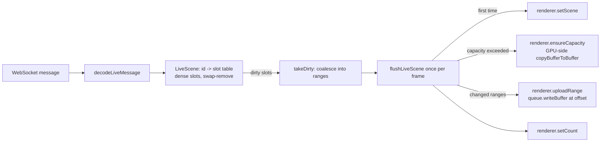

# Live splat streams (`?live=ws://...`)

splatweb can render a Gaussian-splat map **while it is being built**: a scanner (for example
[splatscan](https://github.com/coopersimpson101-debug/splatscan), which tracks a device with
insight-vio and optimises splats online) sends incremental additions, updates and removals over a
WebSocket, and splatweb applies them to its GPU buffers in place, without reloading the scene.

```
http://localhost:5173/?live=ws://127.0.0.1:8765
http://localhost:5173/?live=ws://127.0.0.1:8765&follow=1          # look through the scanner's camera
http://localhost:5173/?live=ws://127.0.0.1:8765&clip=-5,-5,-1,5,5,2.6   # crop box (cut the ceiling off)
```

To try it without hardware, replay a recorded scan with splatscan's server:

```bash
python -m splatscan.server --replay runs/scan/stream.sslog --port 8765 --speed 1 --loop
```

## Protocol v1

One protocol message per WebSocket **binary** message. All integers and floats are
little-endian. This is the same spec as splatscan's `docs/protocol.md`; a fixture written by
splatscan's Python encoder is decoded in `tests/live.test.ts`.

| Field | Type | Notes |
|---|---|---|
| magic | `u32` | `0x31435353` (ASCII `SSC1`) |
| type | `u8` | see below |
| flags | `u8` | 0 |
| reserved | `u16` | 0 |
| seq | `u32` | sender's message counter (informational) |

| type | name | payload |
|---|---|---|
| 1 | HELLO | `u16 version (=1)`, `u8 shDegree`, `u8 upAxis (1 = +y, 2 = +z)`, `u32 capacityHint`, `f32 sceneRadius` |
| 2 | ADD | `u32 n`, then `n` splat records |
| 3 | UPDATE | `u32 n`, then `n` splat records (replace every field of an existing id) |
| 4 | REMOVE | `u32 n`, then `n × u32 id` |
| 5 | FRAME | `f64 t`, `u32 frameIndex`, `u32 splatCount`, `f32 R_wc[9]` (row-major), `f32 p_wc[3]`, `f32 fx, fy, cx, cy`, `u16 width, height`, `f32 psnr` (NaN = unknown) |
| 6 | RESET | (empty) remove every splat |

**Splat record** (`4 + 4·(11 + 3K)` bytes, `K = (shDegree+1)²`, 96 bytes at degree 1):
`u32 id`, `f32 pos[3]`, `f32 scale[3]` (linear standard deviations), `f32 rot[4]` (unit
quaternion w, x, y, z), `f32 opacity` (0..1, sigmoid already applied), `f32 sh[K][3]`
(coefficient-major, RGB interleaved; the same constants and colour rule `max(0, Σ Y_k c_k + 0.5)`
as `src/core/sh.ts`).

FRAME poses are **camera → world** in the computer-vision camera convention (x right, y down,
z forward) in the stream's world frame. `viewFromFrame()` converts one to a splatweb view matrix.

Receiver rules (what `LiveScene` does): an ADD for a known id acts as an UPDATE, an UPDATE for an
unknown id acts as an ADD, a REMOVE for an unknown id is ignored. This makes a late joiner safe
even if it sees a delta that its snapshot already contained.

## How the loader avoids full reloads



* **Dense slots.** Splats occupy slots `[0, loaded)`. A REMOVE moves the last slot into the hole
  (one record re-uploaded), so the GPU never preprocesses or sorts tombstones.
* **Dirty ranges.** Every write marks its slot dirty; once per frame dirty slots are merged into
  ranges (gaps up to 32 slots are merged, since one bigger `writeBuffer` beats many small ones)
  and uploaded with `queue.writeBuffer` at the slot offset.
* **Growth in place.** When the CPU mirror outgrows the GPU allocation, `ensureCapacity()`
  allocates bigger buffers and copies the old contents **on the GPU** (`copyBufferToBuffer`);
  only the sorter scratch and bind groups are rebuilt. Nothing already uploaded is re-sent.
* **CPU sort fallback.** The CPU depth-sort cache also keys on a content version, so updated
  positions are re-sorted.

## Library API

```ts
import { SplatRenderer, connectLive, flushLiveScene, upAxisModelMatrix } from 'splatweb';

const renderer = new SplatRenderer({ device, colorFormat });
const live = connectLive('ws://10.0.0.42:8765', {
  onMessage: (m) => { if (m.type === 'hello') renderer.modelMatrix = upAxisModelMatrix(m.hello.upAxis); },
});
const state = {};
function frame() {
  flushLiveScene(live.scene, renderer, state);   // uploads only what changed
  renderer.render(target, view);
  requestAnimationFrame(frame);
}
```

For engines that embed splatweb (see [vanta-integration.md](vanta-integration.md)), the host
only has to call `flushLiveScene()` before `encode()`; nothing else in the host contract changes.

## Tests

* `tests/live.test.ts` (runs everywhere): decoding and validation, add / update / swap-remove /
  growth / crop box / reset, dirty-range coalescing, the flush contract against a fake renderer,
  pose conversion against `lookAt`, the Python-encoded fixture, and a real WebSocket round trip
  using Node's built-in `WebSocket` client against a minimal in-test RFC 6455 server.
* `tests/gpu.test.ts` (real WGSL through Dawn): after in-place growth, updates and swap-removes,
  the GPU splat and SH buffers are byte-identical to a fresh full upload of the same data, the
  rendered pixels are identical, and the GPU sort self-test passes.

## Headless capture

`scripts/live_capture.ts` connects to a stream, applies messages strictly in order and renders a
frame with Dawn at every FRAME marker from a fixed camera. splatscan uses it to make the right
half of its hero GIF.
